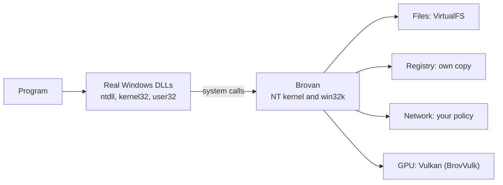

# Brovan FAQ

Answers to the questions people ask most.

[README](README.md) &nbsp;·&nbsp; [Wiki](https://github.com/AdvDebug/Brovan/wiki) &nbsp;·&nbsp; [Ask a question](https://github.com/AdvDebug/Brovan/issues)

> [!NOTE]
> **The short version.** Many games and programs run, and some do not yet. Programs cannot change your files or go online unless you allow it, though on a Windows host they can still read them. For speed, turn on Windows Hypervisor Platform.

<table>
  <tr>
    <th width="50%" align="left">Using Brovan</th>
    <th width="50%" align="left">Design and comparisons</th>
  </tr>
  <tr>
    <td valign="top">
      <a href="#how-do-i-install-brovan">How do I install Brovan?</a> 
      <a href="#will-my-game-or-program-work">Will my game or program work?</a> 
      <a href="#how-do-i-make-it-run-faster">How do I make it run faster?</a> 
      <a href="#do-i-need-windows-files-on-linux-or-android">Do I need Windows files on Linux or Android?</a> 
      <a href="#is-it-safe-to-run-programs-i-do-not-trust">Is it safe to run programs I do not trust?</a> 
      <a href="#where-are-my-saves">Where are my saves?</a> 
      <a href="#why-does-windows-say-windows-protected-your-pc">Why does Windows say "Windows protected your PC"?</a> 
      <a href="#why-does-the-first-start-ask-for-administrator-rights">Why does the first start ask for administrator rights?</a>
    </td>
    <td valign="top">
      <a href="#how-does-brovan-work">How does Brovan work?</a> 
      <a href="#how-does-brovan-compare-to-other-tools">How does Brovan compare to other tools?</a> 
      <a href="#why-not-just-use-a-virtual-machine-or-qemu">Why not just use a virtual machine or QEMU?</a> 
      <a href="#how-is-brovan-different-from-wine-or-proton">How is Brovan different from Wine or Proton?</a> 
      <a href="#how-is-brovan-different-from-qiling-binee-or-unicornpe">How is Brovan different from Qiling, Binee or UnicornPE?</a> 
      <a href="#how-does-brovan-sandbox-programs">How does Brovan sandbox programs?</a>
    </td>
  </tr>
</table>

## Using Brovan

### How do I install Brovan?

Download Brovan for [Windows](https://github.com/AdvDebug/Brovan/releases/download/latest-build/Brovan-win-x64.zip), [Linux](https://github.com/AdvDebug/Brovan/releases/download/latest-build/Brovan-linux-x64.tar.gz) or [Android](https://github.com/AdvDebug/Brovan/releases/download/latest-build/Brovan-android-arm64.apk) from the [latest build](https://github.com/AdvDebug/Brovan/releases/tag/latest-build), which updates after every successful build. Extract it and open **BrovanGUI**, or install the APK on Android. The [Get started](README.md#get-started) steps in the README walk you through the rest.

### Will my game or program work?

Maybe. Brovan is in early development, so many games and programs run and some do not yet. Games with kernel anti-cheat do not run, because Brovan does not load drivers. If your program does not work, please [open an issue](https://github.com/AdvDebug/Brovan/issues) with its name and what happened.

> [!TIP]
> Online games need network access. Set **Network access** to **Full access** in the game's settings in BrovanGUI, or pass `--net=full` on the command line.

### How do I make it run faster?

On Windows, turn on **Windows Hypervisor Platform** under *Turn Windows features on or off* and restart. On Linux, give your user access to `/dev/kvm`. BrovanGUI then runs programs on the real CPU instead of emulating it, which is much faster.

If BrovanGUI still says it is not available, turn on virtualization (Intel VT-x, AMD-V or SVM) in your PC's BIOS.

### Do I need Windows files on Linux or Android?

Yes. Windows programs need the real Windows system files, and Brovan does not include any Microsoft files. On Linux, pick a Windows 11 ISO in BrovanGUI's **Setup**, and Brovan imports the files once. On Android, the app's setup asks for a Windows ISO on your phone and imports the files the same way. Using them needs a valid Windows license. On Windows, Brovan uses the files you already have.

### Is it safe to run programs I do not trust?

Programs cannot change your files or reach the internet unless you allow it, but on a Windows host they can still **read** your files. Brovan itself is mostly written in memory-safe C#. [The sandbox answer](#how-does-brovan-sandbox-programs) below has the details.

### Where are my saves?

In the `VirtualFS` folder next to Brovan. Everything a program writes ends up there.

### Why does Windows say "Windows protected your PC"?

The builds are not signed yet. Click **More info**, then **Run anyway**.

### Why does the first start ask for administrator rights?

Brovan copies your Windows registry into its own folder once, so programs see the right settings. It asks only the first time.

## Design and comparisons

### How does Brovan work?

Brovan runs one program at a time, not a whole operating system. The program loads the real Windows system DLLs, such as `ntdll.dll`, `kernel32.dll` and `user32.dll`, from your own Windows installation or from a Windows image you import once. Those DLLs ask the kernel for help through system calls, and Brovan is that kernel.

Brovan implements the NT kernel and win32k system calls, and the services that programs talk to, such as CSRSS, RPCSS, the console, audio and the Steam client. The program's own code runs on Unicorn, which emulates the CPU on any host and supports every analysis feature, or on the real CPU through Windows Hypervisor Platform or KVM, which is much faster but leaves some analysis features out.

### How does Brovan compare to other tools?

| | **Brovan** | Virtual machine | Wine / Proton | Qiling |
|---|:---:|:---:|:---:|:---:|
| Runs | One program | A whole OS | One program | One program |
| Windows code | Real Windows DLLs | Real Windows | Wine's own DLLs | Python API handlers |
| Runs on | Windows, Linux, Android | Desktop OSes | Linux, macOS | Anywhere Python runs |
| Sandboxed by default | Yes | Yes | No | Partly |
| Edit system calls live | Yes | With extra tools | No | Yes |
| Games on your GPU | Yes | Limited | Yes | No |

### Why not just use a virtual machine or QEMU?

A virtual machine runs a whole operating system on a kernel you do not control. That makes it faithful but hard to see into, and 3D graphics inside a VM are usually slow. Brovan runs just the program: there is nothing to install, its windows open on your own desktop, and games use your real GPU.

For analysis, Brovan is the kernel, so it sees every system call and can stop, change or record it, without debug registers or code changes the program could notice.

### How is Brovan different from Wine or Proton?

Wine and Proton reimplement the Windows API for Linux and macOS. Brovan keeps Windows' own DLLs and implements only the kernel under them, so far less of Windows is rewritten. It also runs on Windows and Android, keeps every program in a sandbox, and lets you trace and change anything the program does.

### How is Brovan different from Qiling, Binee or UnicornPE?

These tools mostly hook Windows API functions and reimplement them, so every API a program needs has to be rewritten. Brovan works one level lower: the real DLLs handle the APIs and Brovan implements only the system calls under them. That keeps behavior close to real Windows and lets Brovan run full GUI programs and games.

Each has its place. Qiling offers a Python API and many CPU architectures. Brovan is scripted through its debugger commands and runs x86 and x86-64 programs, plus raw 32-bit ARM and Thumb code.

### How does Brovan sandbox programs?

| Area | What Brovan does |
|---|---|
| **Writing files** | Everything a program writes goes to the `VirtualFS` folder next to Brovan. It never overwrites or deletes your own files. Path traversal and symlink tricks that would escape are blocked. |
| **Reading files** | On a Windows host, a Windows program can read your files, because that is how it finds its own data and the system DLLs. Reads look in `VirtualFS` first. On Linux and Android hosts, a program sees only `VirtualFS`, the imported Windows files and its own folder, which are read-only. |
| **Windows vs Linux programs** | Each gets its own virtual file system and cannot see the other one. |
| **Registry** | Windows programs use Brovan's own copy of the registry, in the `WinReg` folder. Your real registry is never changed. |
| **Network** | By default a program can only connect to your own computer. `--net=full` allows everything, `--net=none` blocks even local connections, and `--net-allow=<ip>` allows one more address. |
| **Processes** | When a Windows program starts another program, that one runs in its own Brovan instance, in the same sandbox. Linux programs cannot start new processes yet. |
| **Drivers** | Brovan does not load kernel drivers, so a program cannot install one. |
| **Console** | Escape sequences that could take over your terminal are filtered. Normal colors and text styling still work. |
| **Memory safety** | Brovan's kernel, its services and the host side of the Vulkan bridge are written in C#. The .NET runtime checks every array index, cast and object reference, so buffer overflows and use-after-free bugs, the kind that often break sandboxes written in C or C++, are very unlikely there. A small share of the code works with memory directly for speed, as does the CPU emulator, Unicorn, which is written in C. The Vulkan bridge and the file parsers are also fuzz-tested every night. |

> [!TIP]
> Studying real malware? Analysts usually add a second layer to any sandbox, such as a virtual machine or a spare PC. That is standard practice, and it works with Brovan too.
