

  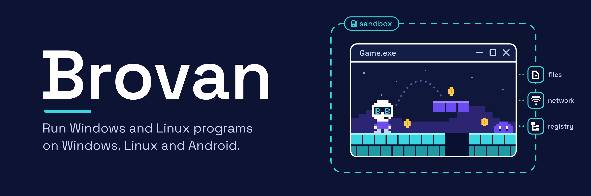

  <h3>Play games, try untrusted programs safely, and see everything they do.</h3>

  
  

  <b><a href="#get-started">Get started</a></b> &nbsp;·&nbsp; <b><a href="#for-researchers">For researchers</a></b> &nbsp;·&nbsp; <a href="FAQ.md">FAQ</a> &nbsp;·&nbsp; <a href="https://github.com/AdvDebug/Brovan/wiki">Wiki</a>

 

<table>
  <tr>
    <td width="33%" align="center">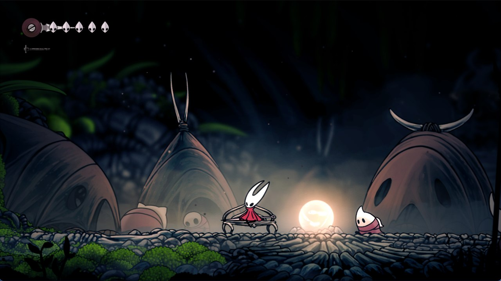 Hollow Knight: Silksong</td>
    <td width="33%" align="center">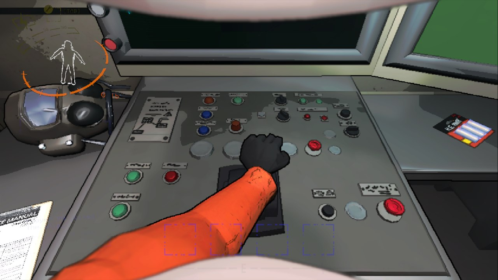 Lethal Company</td>
    <td width="33%" align="center">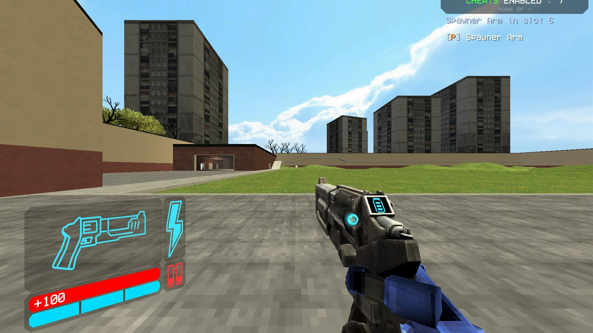 ULTRAKILL</td>
  </tr>
  <tr>
    <td width="33%" align="center">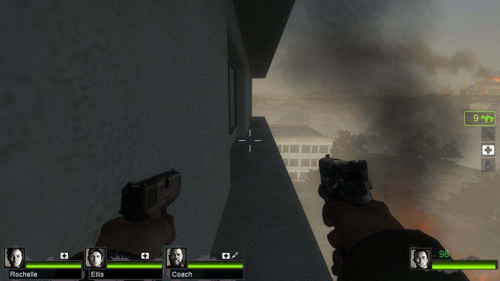 Left 4 Dead 2</td>
    <td width="33%" align="center">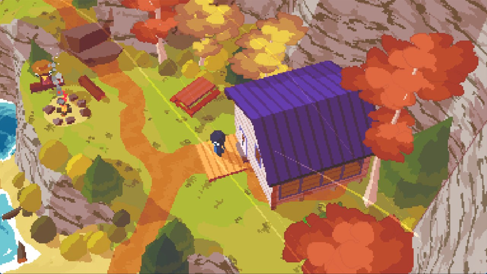 A Short Hike</td>
    <td width="33%" align="center">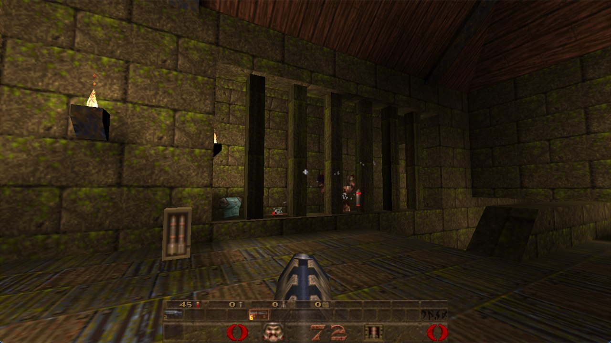 vkQuake</td>
  </tr>
</table>

Real captures from Brovan on Windows Hypervisor Platform. How well a game runs varies, so check the <a href="FAQ.md#will-my-game-or-program-work">FAQ</a>.

## What is Brovan?

Brovan runs Windows programs and games in a sandbox, on Windows, Linux and Android.

<table>
  <tr>
    <td width="33%" valign="top"><b>Play</b> Windows games on your own GPU, even on Android. <a href="#get-started">Get started</a></td>
    <td width="33%" valign="top"><b>Try safely</b> Programs cannot change your files or go online unless you let them. <a href="FAQ.md#how-does-brovan-sandbox-programs">How the sandbox works</a></td>
    <td width="33%" valign="top"><b>Analyze</b> See every system call and API call, and stop or change any of them. <a href="#for-researchers">For researchers</a></td>
  </tr>
</table>

> [!NOTE]
> Brovan is in early development. Many games and programs run, and some do not yet. If something breaks, check the [FAQ](FAQ.md) or [open an issue](https://github.com/AdvDebug/Brovan/issues).

## Get started

### On Windows and Linux

1. **Download** Brovan for [Windows](https://github.com/AdvDebug/Brovan/releases/download/latest-build/Brovan-win-x64.zip) or [Linux](https://github.com/AdvDebug/Brovan/releases/download/latest-build/Brovan-linux-x64.tar.gz) from the [latest build](https://github.com/AdvDebug/Brovan/releases/tag/latest-build).
2. **Extract it** and open **BrovanGUI**.
3. **Open Setup** and click **Install the latest** next to DXVK, which most games need. On Linux, also pick a Windows 11 ISO there. Brovan takes the Windows system files from it.
4. **Click +** next to **Library**, choose the game's `.exe`, and click **Launch**.

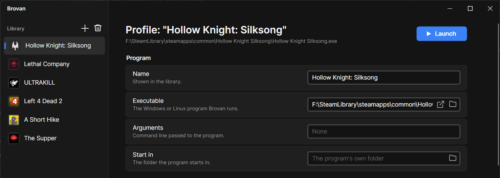

<b>Make games run faster</b>

 

On Windows, Brovan runs much faster with **Windows Hypervisor Platform**, which is part of Windows but off by default.

1. Open the Start menu, type **Turn Windows features on or off** and open it.
2. Tick **Windows Hypervisor Platform**, click **OK**, and restart.

If BrovanGUI still says it is not available, turn on virtualization (Intel VT-x, AMD-V or SVM) in your PC's BIOS. On Linux, Brovan uses KVM, and your user needs access to `/dev/kvm`.

### On Android

Install [the APK](https://github.com/AdvDebug/Brovan/releases/download/latest-build/Brovan-android-arm64.apk) from the latest build, open the app and follow its setup. One step asks for a Windows ISO on your phone and imports the system files from it. The app can open Microsoft's download page if you need one.

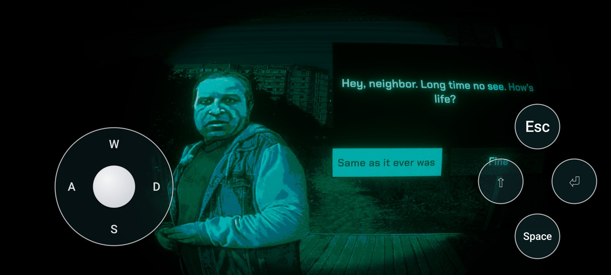 No, I'm Not a Human on a Pixel 7, with Brovan's on-screen controls

## For researchers

Brovan works at the system call level. The real Windows DLLs run inside the guest, and Brovan implements the NT kernel, win32k and the system services under them, so every call into the kernel can be traced, stopped or changed.

- **Debugger:** conditional breakpoints, read/write/execute watchpoints, stepping and snapshots
- **Tracing:** live system call and API call traces, exported to JSON, CSV or text
- **Control:** rules that allow, deny or rewrite system calls, and ghost patches the program cannot see
- **Network:** traffic capture to PCAP, with loopback-only access by default
- **Inputs:** 64-bit and 32-bit PE, 64-bit ELF, memory dumps and raw shellcode
- **Backends:** Unicorn on any host, with the full analysis toolset, or WHP on Windows and KVM on Linux for speed

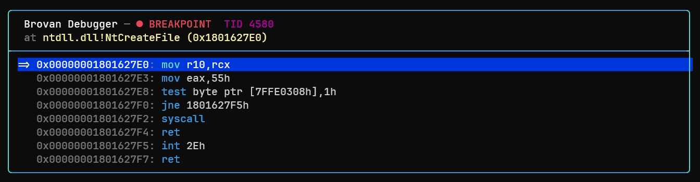 A breakpoint on <code>ntdll!NtCreateFile</code>, with the disassembly at that address

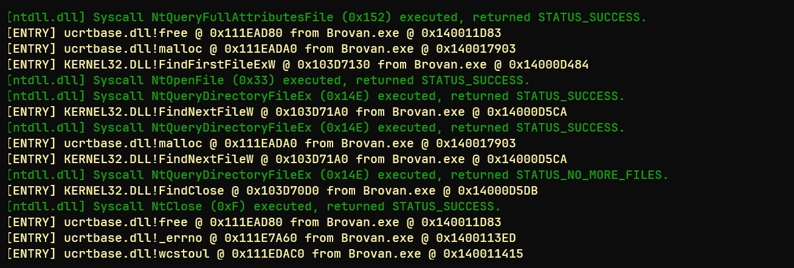 API calls and system calls, traced live

The wiki documents [the commands](https://github.com/AdvDebug/Brovan/wiki/Brovan-Usage), including scripting from the command line, and the [architecture](https://github.com/AdvDebug/Brovan/wiki/Architecture). The [FAQ](FAQ.md) explains the sandbox and how Brovan compares to other tools.

## Contributing

Bug reports, fixes and new system calls are all welcome. [CONTRIBUTING.md](CONTRIBUTING.md) shows where to start and how to build Brovan.

## Credits

- [Iced](https://github.com/icedland/iced) for disassembly and assembly.
- [Unicorn Engine](https://github.com/unicorn-engine/unicorn) for the core emulator.
- [DXVK](https://github.com/doitsujin/dxvk) for Direct3D on top of Vulkan.
- [Mesa](https://www.mesa3d.org) for Zink, which gives Windows programs OpenGL.
- [clvk](https://github.com/kpet/clvk) and [clspv](https://github.com/google/clspv) for OpenCL, built with [LLVM](https://github.com/llvm/llvm-project), [SPIRV-Tools](https://github.com/KhronosGroup/SPIRV-Tools) and [SPIRV-LLVM-Translator](https://github.com/KhronosGroup/SPIRV-LLVM-Translator).

Thanks to my friends [GittingHubbers](https://github.com/GittingHubbers) for help with the MLFQ scheduler, and [Adam (Zypherion Technologies)](https://github.com/ZypherionTechnologies) for help with various parts of the emulator.

## License

Brovan is licensed under the [MIT License](LICENSE).

The Unicorn patches in [Brovan/native/unicorn](Brovan/native/unicorn) are GPL-2.0, like
[Unicorn](https://github.com/unicorn-engine/unicorn) itself. Brovan's releases include Unicorn, so a release as a whole
is distributed under the GPL-2.0, but Brovan's own code in it stays MIT and can be reused under MIT without Unicorn.
